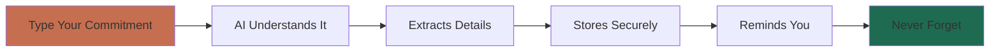
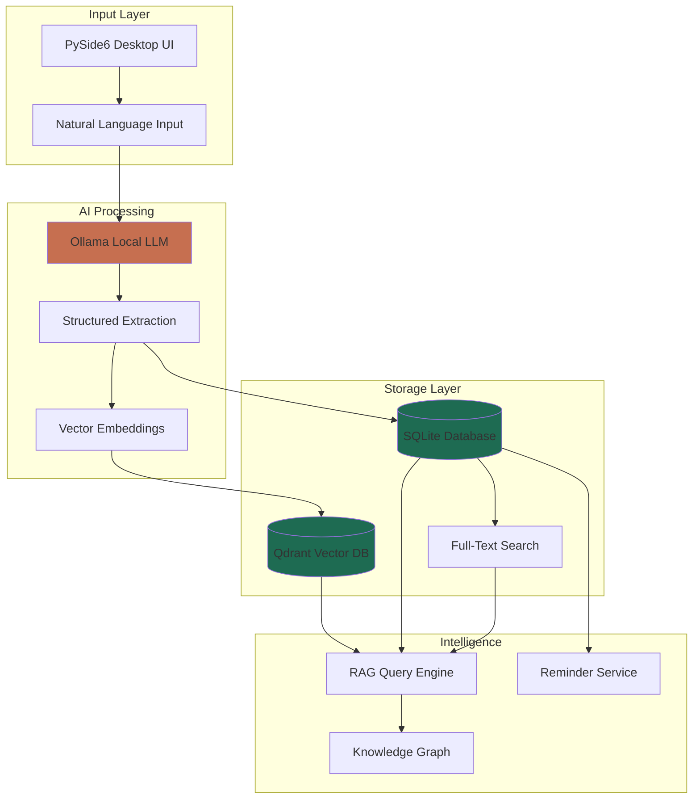
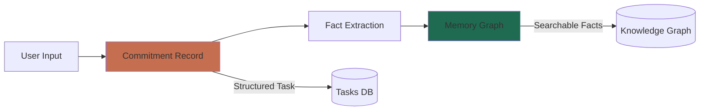
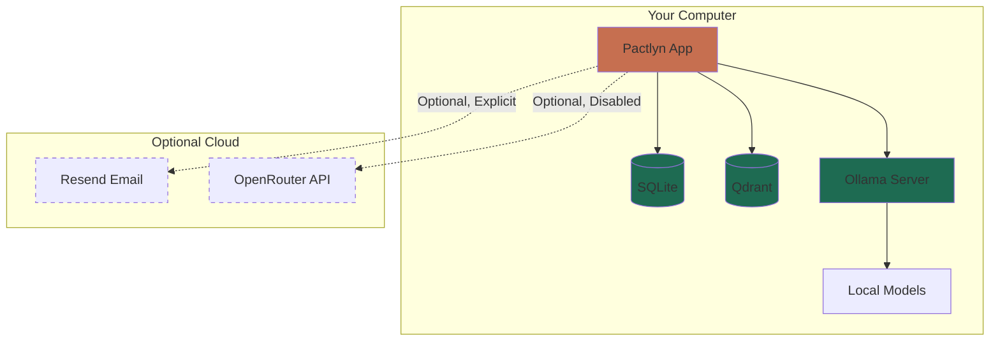

# Pactlyn — Remember What Matters

<div align="center">

**Your Local-First Personal Commitment Assistant**

[](LICENSE)
[](https://www.python.org/downloads/)

[What is Pactlyn?](#what-is-pactlyn) •
[Quick Start](#quick-start) •
[How It Works](#how-it-works) •
[Documentation](#documentation) •
[For Developers](#for-developers)

</div>

---

## 📖 Table of Contents

- [What is Pactlyn?](#what-is-pactlyn)
  - [The Problem](#the-problem)
  - [The Solution](#the-solution)
  - [Key Features](#key-features)
- [Quick Start](#quick-start)
  - [Installation](#installation)
  - [First Launch](#first-launch)
- [How It Works](#how-it-works)
  - [For Non-Technical Users](#for-non-technical-users)
  - [For Technical Users](#for-technical-users)
- [Core Concepts](#core-concepts)
- [Documentation](#documentation)
- [For Developers](#for-developers)
- [Roadmap](#roadmap)
- [License](#license)

---

## What is Pactlyn?

### The Problem

**Ever felt overwhelmed by scattered commitments?**

- "I promised to email Sarah back by Friday" — but forgot
- "Need to submit assignment by Tuesday" — buried in chat history
- "Waiting for John's approval" — no tracking, no reminder
- Your tasks, promises, and follow-ups are spread across sticky notes, emails, and messages

**Traditional solutions fall short:**
- ❌ Cloud todo apps require internet and expose your private data
- ❌ Calendar apps don't understand natural language commitments
- ❌ Note apps can't remind you or extract structured tasks
- ❌ AI assistants send your data to external servers

### The Solution

**Pactlyn is your private AI assistant that:**
- ✅ Runs 100% locally on your computer (no cloud required)
- ✅ Understands natural language: "I need to submit my assignment by Friday"
- ✅ Extracts structured commitments with deadlines, people, and dependencies
- ✅ Reminds you at the right time
- ✅ Answers questions: "What am I waiting for?" or "What's due this week?"
- ✅ Keeps your data private — everything stays on your device

### Key Features

🔒 **Privacy First**: All data stored locally in SQLite, never leaves your machine  
🤖 **AI-Powered**: Uses local Ollama models to understand your commitments  
📝 **Smart Extraction**: Converts "I told John I'd send the report by Monday" into structured tasks  
🔍 **Intelligent Search**: RAG-powered memory to answer questions about your commitments  
📧 **Email Integration**: Draft and approve follow-up emails (with your explicit consent)  
⏰ **Smart Reminders**: Never miss a deadline or follow-up  
🌐 **Offline Ready**: Works without internet after setup

---

## Quick Start

### Installation

**Prerequisites:**
- Linux (Ubuntu/Debian recommended)
- Python 3.11 or higher
- Ollama (for local AI models)

**Step 1: Install Dependencies**

```bash
# Install Python and system packages
sudo apt install python3 python3-venv

# Install uv (fast Python package manager)
curl -LsSf https://astral.sh/uv/install.sh | sh
```

**Step 2: Install Ollama & Models**

```bash
# Install Ollama
curl -fsSL https://ollama.com/install.sh | sh

# Download recommended models (lightweight, fast)
ollama pull qwen2.5:3b        # Chat model (2GB)
ollama pull nomic-embed-text  # Embedding model (274MB)

# Start Ollama server
ollama serve
```

**Step 3: Install & Run Pactlyn**

```bash
# Clone and setup
git clone https://github.com/yourusername/pactlyn-ai.git
cd pactlyn-ai

# Install with development dependencies
uv sync --extra dev

# Initialize database
uv run alembic upgrade head

# Launch Pactlyn
uv run pactlyn
```

### First Launch

1. **Configure Models** (Settings → AI Models):
   - Select your chat model: `qwen2.5:3b`
   - Select embedding model: `nomic-embed-text`
   - Models auto-discovered, preferences auto-saved

2. **Try Your First Commitment**:
   - Go to Home page
   - Type: "I need to submit my project report by Friday 5pm"
   - Click "Capture" → Review extracted details → Save
   - Done! Pactlyn will remind you before the deadline

3. **Ask Questions**:
   - Go to Assistant page
   - Ask: "What am I waiting for?"
   - Get AI-powered answers from your stored commitments

---

## How It Works

### For Non-Technical Users



**Simple Workflow:**

1. **Capture**: Type naturally — "Promised Sarah I'd send the document by Wednesday"
2. **Review**: AI extracts who (Sarah), what (send document), when (Wednesday)
3. **Store**: Saved to your local database, searchable forever
4. **Remember**: Get reminded before deadlines
5. **Query**: Ask "What's overdue?" or "What did I promise John?"

**Example Use Cases:**

| You Say | Pactlyn Understands |
|---------|---------------------|
| "Need to email client about invoice by EOD Friday" | Task: Email client<br>Deadline: Friday 5pm<br>Type: USER_PERFORMS |
| "Waiting for John's approval on the proposal" | Person: John<br>Type: USER_WAITING_FOR<br>Action: Approval needed |
| "Remind me to call Mom next Sunday" | What: Call Mom<br>When: Next Sunday<br>Reminder: Created |

### For Technical Users



**Architecture Highlights:**

- **Frontend**: PySide6 (Qt) desktop application
- **LLM**: Ollama with pluggable model support (qwen2.5, llama3.2, etc.)
- **Storage**: 
  - SQLite with SQLAlchemy ORM for structured data
  - Qdrant (local mode) for vector embeddings
  - FTS5 for full-text search
- **RAG Pipeline**: 
  - Document chunking with PyMuPDF
  - Semantic search via embedding similarity
  - Context-aware answer generation
- **Privacy**: Zero network calls for core features (post-setup)

**Tech Stack:**

| Component | Technology | Purpose |
|-----------|-----------|---------|
| UI Framework | PySide6 (Qt) | Native desktop interface |
| Database | SQLite + SQLAlchemy | Relational data storage |
| Vector Store | Qdrant (local) | Semantic search embeddings |
| LLM Runtime | Ollama | Local model inference |
| Document Parser | PyMuPDF | PDF text extraction |
| Email | Resend API (optional) | Outbound email with approval |
| Orchestration | LangGraph | Multi-step AI workflows |

---

## Core Concepts

### 1. Commitments vs Memory



**Commitments**: Actionable tasks with deadlines, people, dependencies
- Example: "Submit report to Sarah by Friday"
- Stored in: Commitments table (SQLite)
- View in: Commitments page

**Memory**: Extracted facts and relationships from all your captures
- Example: "Report is for Sarah", "Deadline is Friday", "Sarah prefers PDF format"
- Stored in: Memory graph (Qdrant vectors + SQLite relations)
- View in: Memory page, queryable via Assistant

### 2. Search Modes in Assistant

| Mode | What It Searches | Use When |
|------|-----------------|----------|
| **Commitments & Records** | Your captured tasks and commitments | "What am I waiting for?" |
| **Uploaded Documents** | PDFs you've uploaded for Q&A | "Summarize this contract" |
| **Both (Hybrid)** | Everything — tasks + documents | "What deadlines relate to the Smith project?" |

### 3. Local-First Privacy



**What Stays Local:**
- ✅ All commitments and tasks
- ✅ Uploaded documents (PDFs)
- ✅ Memory and knowledge graph
- ✅ AI model inference (via Ollama)
- ✅ Embeddings and vector search

**What Requires Internet (Optional):**
- 📧 Sending approved emails via Resend (explicit consent required)
- 🌐 Using OpenRouter cloud models (disabled by default, must be enabled)
- 📥 Polling Resend inbox for inbound emails (optional feature)

---

## Documentation

### User Guides

- 📘 **[How to Use Pactlyn](docs/user-guide.md)** — Complete walkthrough for new users
- 🎯 **[Common Workflows](docs/workflows.md)** — Email tracking, project management, meeting follow-ups
- ⚙️ **[Settings Guide](docs/settings.md)** — Configure models, email, themes

### Technical Documentation

- 🏗️ **[Architecture Overview](docs/architecture.md)** — System design, data flow, components
- 🔒 **[Privacy & Security](docs/privacy.md)** — How your data is protected
- 📴 **[Offline Mode](docs/offline-mode.md)** — What works without internet
- 📧 **[Email Setup](docs/resend-setup.md)** — Configuring Resend for follow-ups
- 🧪 **[Evaluation Reports](docs/evaluation.md)** — Performance benchmarks and validation

### Development

- 🛠️ **[Developer Setup](docs/development.md)** — Contributing guidelines
- 🧪 **[Testing Guide](docs/testing.md)** — Running tests, coverage reports
- 📊 **[Validation Reports](docs/)** — v0.2, v0.3, v0.5, v0.6, v0.7, v0.8 reports

---

## For Developers

### Development Setup

```bash
# Clone repository
git clone https://github.com/yourusername/pactlyn-ai.git
cd pactlyn-ai

# Install with dev dependencies
uv sync --extra dev

# Run tests
uv run pytest

# Check code quality
uv run ruff check src tests
uv run mypy src

# Run with coverage
uv run coverage run --source=src/pactlyn -m pytest
uv run coverage report -m
```

### Project Structure

```
pactlyn-ai/
├── src/pactlyn/
│   ├── ui/              # PySide6 desktop interface
│   ├── llm/             # Ollama, OpenRouter providers
│   ├── rag/             # Document RAG pipeline
│   ├── storage/         # SQLAlchemy models
│   ├── graph/           # Knowledge graph logic
│   ├── email/           # Resend integration
│   └── app/             # Application bootstrap
├── docs/                # Documentation
├── evaluation/          # Validation datasets & scripts
├── tests/               # Test suite
└── migrations/          # Alembic database migrations
```

### Key Technologies

**Languages & Frameworks:**
- Python 3.11+ (asyncio, type hints)
- PySide6 for desktop UI
- SQLAlchemy 2.0 for ORM

**AI & ML:**
- Ollama for local LLM inference
- Qdrant for vector embeddings
- LangGraph for workflow orchestration

**Data Storage:**
- SQLite with FTS5 full-text search
- Qdrant local persistent mode
- Alembic for schema migrations

### Contributing

We welcome contributions! See [CONTRIBUTING.md](CONTRIBUTING.md) for:
- Code style guidelines (Ruff, mypy)
- Testing requirements
- PR process
- Development workflow

---

## Challenges & Solutions

### Challenge 1: Privacy vs Convenience

**Problem**: Cloud AI assistants are convenient but expose private data.

**Solution**: Run everything locally with Ollama. Post-setup, zero network calls for core features. Optional cloud services (email) require explicit approval per action.

### Challenge 2: Natural Language Understanding

**Problem**: Converting "I told Sarah I'd send the report by EOD" into structured data is hard.

**Solution**: LangGraph workflows with LLM-powered extraction, user review, and editable fields. Offline fallback uses rule-based parsing when models unavailable.

### Challenge 3: Reminder Accuracy

**Problem**: Users want "next Tuesday" or "end of week" understood correctly.

**Solution**: Dateparser library for natural language dates + explicit ISO format support. Timezone-aware datetime handling.

### Challenge 4: Performance on Consumer Hardware

**Problem**: Large LLMs (70B+) are too slow for desktop use.

**Solution**: 
- Optimized for small models (3B-7B parameters)
- Async processing to keep UI responsive
- Configurable timeouts (600s default)
- Model recommendations: qwen2.5:3b (fast), qwen2.5:7b (balanced)

---

## Roadmap

**Version 0.9 (Current Development)**
- [ ] Enhanced document Q&A with multi-hop reasoning
- [ ] Improved citation formatting
- [ ] Calendar integration (iCal export)
- [ ] Mobile companion app (view-only)

**Version 1.0 (Stable Release)**
- [ ] Windows & macOS support
- [ ] Plugin system for extensibility
- [ ] Advanced relationship tracking
- [ ] Recurring commitment templates

**Future Exploration**
- Voice input integration
- Browser extension for web capture
- Team collaboration (self-hosted server)
- Advanced analytics dashboard

See [docs/roadmap.md](docs/roadmap.md) for detailed plans.

---

## FAQ

**Q: Does Pactlyn send my data to the cloud?**  
A: No. Core features (commitments, memory, document Q&A) run 100% locally. Optional email features require explicit approval per send.

**Q: What models work best?**  
A: For 4GB VRAM: qwen2.5:3b or qwen3:4b. For 8GB+: qwen2.5:7b. Avoid vision models (llava) for text tasks.

**Q: Can I use it offline?**  
A: Yes! After downloading Ollama models, Pactlyn works fully offline for commitments, reminders, and document Q&A.

**Q: How is this different from Todoist/Notion/etc?**  
A: Pactlyn understands natural language, extracts structured data automatically, runs local AI models, and keeps everything private on your device.

**Q: Is my data encrypted?**  
A: Local database is unencrypted (your disk encryption protects it). Backups support password encryption. API keys stored in OS keyring.

**Q: What about Windows/Mac support?**  
A: Currently Linux-only. Windows/Mac support planned for v1.0.

---

## License

MIT License — see [LICENSE](LICENSE) file.

---

## Acknowledgments

Built with:
- [Ollama](https://ollama.com) — Local LLM runtime
- [Qdrant](https://qdrant.tech) — Vector database
- [Qt/PySide6](https://www.qt.io/qt-for-python) — Desktop UI framework
- [SQLAlchemy](https://www.sqlalchemy.org) — Database ORM

---

<div align="center">

**Made with ❤️ for privacy-conscious productivity**

[Report Bug](https://github.com/yourusername/pactlyn-ai/issues) •
[Request Feature](https://github.com/yourusername/pactlyn-ai/issues) •
[Discussions](https://github.com/yourusername/pactlyn-ai/discussions)

</div>
