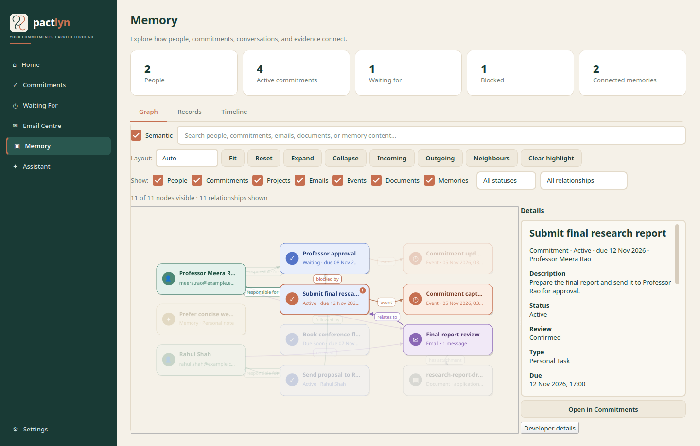

# Pactlyn

**Remember what matters. Follow through.**

Pactlyn is a local-first Linux desktop assistant for commitments, waiting-for
items and approved follow-up email. You can write “I need to submit my
assignment by Friday” and Pactlyn extracts a reviewable commitment, stores it
in SQLite, indexes provenance in local Qdrant and schedules a persistent
reminder. It is designed to remain useful offline after local model setup.

## Current release

The repository contains the 0.9 local-first foundation: a PySide6 desktop
shell, SQLite/SQLAlchemy persistence, Qdrant local-mode storage, a deterministic
capture baseline, Ollama and explicit OpenRouter gateways, a LangGraph capture
workflow, reminder recovery, provenance-aware memory, an interactive native
Memory knowledge graph, settings-driven Resend outbound email and inbound
polling. Desktop capture runs Ollama asynchronously, supports editable
multi-commitment review, and only offers a clearly labelled offline fallback
after a model failure.

The desktop app does not silently use a cloud model. Resend delivery is only
possible after a user approves an exact payload.

## Install and run on Linux

Python 3.11+ is supported by the current environment; Python 3.12+ is
recommended for new installations and required for the mypy check configuration.

```bash
sudo apt install python3 python3-venv  # PySide6 wheels normally need no Qt apt packages
curl -LsSf https://astral.sh/uv/install.sh | sh
uv sync --extra dev
uv run alembic upgrade head   # existing databases; safe/no-op on a fresh install
uv run pactlyn
```

Pactlyn stores data under `~/.local/share/pactlyn/` by default:

* `pactlyn.sqlite3` — canonical structured data, FTS5 and audit records
* `qdrant/` — Qdrant local persistent vector collections

Set `PACTLYN_DATA_DIR` to choose another private directory. Do not put it in a
shared or synchronised folder. `.env.example` lists non-secret settings.

## Ollama setup

Install Ollama from <https://ollama.com>, then install a chat model and an
embedding model, for example:

```bash
ollama pull llama3.2:3b
ollama pull nomic-embed-text
```

Pactlyn checks the local endpoint at `http://127.0.0.1:11434`. Configure it
with `PACTLYN_OLLAMA_URL`, `PACTLYN_OLLAMA_MODEL` and
`PACTLYN_OLLAMA_EMBEDDING_MODEL`. If Ollama is unavailable, the UI explains the
failure and asks before using the conservative rule-based fallback; model output
is never treated as confirmed fact automatically.

## Email setup

Resend is optional and online-only. Configure it entirely in **Settings →
Email**:

* enter your personal identity, signature and preferred tone;
* save a Resend API key (masked, stored only in the OS keyring, never in SQLite
  or `.env`);
* enter a sender address at a domain verified in Resend — a personal Gmail or
  Outlook address cannot be the sender;
* optionally enter a Resend receiving address, enable inbound synchronisation
  and choose a polling interval;
* choose whether new drafts reply to your personal address or the receiving
  address;
* click **Test connection** for a read-only credential/domain/inbox check.

Pactlyn always requires approval of the exact payload before sending. **Send
test email** is a separate explicit action with a full preview and confirmation;
it uses the same draft/approval/queue path, and only that action is processed.
Inbound mail is polled through Resend; this is not unrestricted Gmail or Outlook
inbox synchronisation. Email content necessarily passes through Resend during
transmission.

Saved Settings → Email values take precedence over environment variables.
`PACTLYN_RESEND_FROM`, `PACTLYN_RESEND_INBOUND_ADDRESS` and
`PACTLYN_RESEND_API_KEY` are development/test/CI fallbacks only, used before the
first save. See [Resend setup](docs/resend-setup.md) for details and
troubleshooting.

## Memory

**Memory** is an interactive knowledge graph over the records already stored in
SQLite. It opens on the Graph view and also provides Records and Timeline views.
The graph is drawn with native PySide6 `QGraphicsScene`/`QGraphicsView` items;
there is no embedded web page or JavaScript UI.



Nodes represent real People, Commitments, **Personal Facts**, Emails/threads,
Events, Documents and independent Memories. Typed relationship edges keep their
direction, including `BLOCKED_BY`, `DEPENDS_ON`, `FOLLOWED_BY`,
`RESPONSE_REQUIRED_FROM`, `RELATED_TO` and `SUPERSEDES`. Person responsibility,
email participants, email/commitment associations and attachment links are derived
from stored fields. Personal facts connect from the user profile node with
semantic edge types such as `HAS_BIRTHDAY`, `STUDIES_AT`, `WORKS_ON` and
`PREFERS`.

The Graph view supports selection, dragging, panning, zoom, fit, reset,
relationship-aware layout, neighbour highlighting, expand/collapse, search,
entity/status/relationship filters, details and navigation to the existing
Commitments and Email Centre pages. Qdrant semantic search can suggest related
memories, but semantic similarity never creates a causal graph edge.

See [Memory knowledge graph](docs/memory.md) for node/edge mappings, interaction
details, limits and sample screenshots.

## Offline behavior

SQLite, Qdrant local mode, reminders, memory and email drafts work without
internet. Ollama capture and embeddings work without external internet only
when the local Ollama server and models were installed before isolation.
Approved outbound email actions remain in
the local queue until a configured Resend provider is available. There is no
automatic OpenRouter fallback. OpenRouter is an explicit optional provider,
disabled by default, and must be enabled separately with a credential-store key.

## Backup and restore

Use Settings → Create backup or `BackupService`. Password-protected backups
encrypt the SQLite database and local Qdrant files. Restore requires restarting
Pactlyn so local stores are reopened safely.

## Development and checks

```bash
uv run pytest
uv run coverage run --source=src/pactlyn -m pytest
uv run coverage report -m
uv run ruff check src tests
uv run mypy src
```

External services are replaced with test doubles in ordinary tests. Live
Resend and Ollama checks require explicit user credentials/services and are not
run by the default test suite.

## Architecture

See:

* [Architecture](docs/architecture.md)
* [Memory knowledge graph](docs/memory.md)
* [Linux setup](docs/setup-linux.md)
* [Offline mode](docs/offline-mode.md)
* [Resend setup](docs/resend-setup.md)
* [Privacy](docs/privacy.md)
* [Security](docs/security.md)
* [Testing and evaluation](docs/evaluation.md)
* [0.2 validation report](docs/validation-0.2.md)
* [0.3 validation report](docs/validation-0.3.md)
* [0.9 validation report](docs/validation-0.9.md)
* [Roadmap](docs/roadmap.md)

## License

MIT. See [LICENSE](LICENSE).
