# Pactlyn — Remember What Matters

<div align="center">

**Your Local-First Personal Commitment Assistant**

[](LICENSE)
[](https://www.python.org/downloads/)

[What is Pactlyn?](#what-is-pactlyn) •
[Quick Start](#quick-start) •
[How It Works](#how-it-works) •
[Documentation](#documentation) •
[For Developers](#for-developers)

</div>

---

## 📖 Table of Contents

- [What is Pactlyn?](#what-is-pactlyn)
  - [The Problem](#the-problem)
  - [The Solution](#the-solution)
  - [Key Features](#key-features)
- [Features Deep Dive](#features-deep-dive)
- [Quick Start](#quick-start)
  - [Installation](#installation)
  - [First Launch](#first-launch)
  - [Testing Your Installation](#testing-your-installation)
- [How It Works](#how-it-works)
  - [For Non-Technical Users](#for-non-technical-users)
  - [For Technical Users](#for-technical-users)
- [Core Concepts](#core-concepts)
- [Documentation](#documentation)
- [For Developers](#for-developers)
- [Roadmap](#roadmap)
- [License](#license)

---

## What is Pactlyn?

### The Problem

**Ever felt overwhelmed by scattered commitments?**

- "I promised to email Sarah back by Friday" — but forgot
- "Need to submit assignment by Tuesday" — buried in chat history
- "Waiting for John's approval" — no tracking, no reminder
- Your tasks, promises, and follow-ups are spread across sticky notes, emails, and messages

**Traditional solutions fall short:**
- ❌ Cloud todo apps require internet and expose your private data
- ❌ Calendar apps don't understand natural language commitments
- ❌ Note apps can't remind you or extract structured tasks
- ❌ AI assistants send your data to external servers

### The Solution

**Pactlyn is your private AI assistant that:**
- ✅ Runs 100% locally on your computer (no cloud required)
- ✅ Understands natural language: "I need to submit my assignment by Friday"
- ✅ Extracts structured commitments with deadlines, people, and dependencies
- ✅ Reminds you at the right time
- ✅ Answers questions: "What am I waiting for?" or "What's due this week?"
- ✅ Keeps your data private — everything stays on your device

### Key Features

🔒 **Privacy First**: All data stored locally in SQLite, never leaves your machine  
🤖 **AI-Powered**: Uses local Ollama models to understand your commitments  
📝 **Smart Extraction**: Converts "I told John I'd send the report by Monday" into structured tasks  
🔍 **Intelligent Search**: RAG-powered memory to answer questions about your commitments  
📧 **Email Integration**: Draft and approve follow-up emails (with your explicit consent)  
⏰ **Smart Reminders**: Never miss a deadline or follow-up  
🌐 **Offline Ready**: Works without internet after setup

---

## Features Deep Dive

### 1. 🎯 Smart Commitment Capture

**What it does**: Converts natural language into structured, actionable tasks

**How it works**:

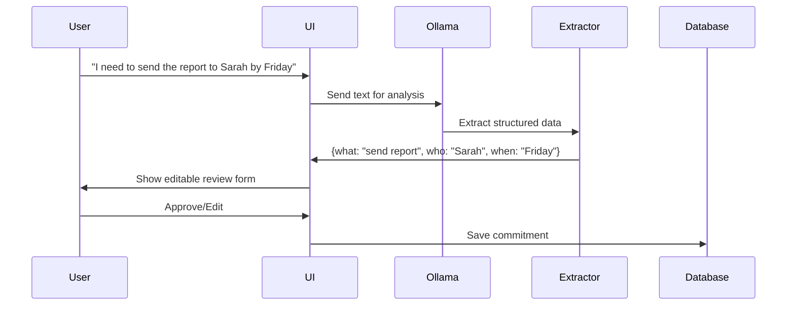

**What you get**:
- **Title**: Brief summary (e.g., "Send report to Sarah")
- **Description**: Full context
- **Person**: Who's involved (Sarah)
- **Email**: Contact info if mentioned
- **Deadline**: Parsed date (Friday 5pm)
- **Type**: TASK, DEADLINE, WAITING_FOR, or EVENT
- **Responsibility**: USER_PERFORMS, USER_WAITING_FOR, OTHER_PARTY_PERFORMS, etc.

**Example transformations**:

| You Type | Pactlyn Extracts |
|----------|------------------|
| "Need to email client about invoice by EOD Friday" | **What**: Email client<br>**Action**: Email about invoice<br>**Deadline**: Friday 5pm<br>**Type**: TASK |
| "Waiting for John's approval on proposal" | **Person**: John<br>**Action**: Approval on proposal<br>**Type**: USER_WAITING_FOR<br>**Responsibility**: OTHER_PARTY_PERFORMS |
| "Call Mom next Sunday at 3pm" | **Person**: Mom<br>**Action**: Call<br>**Deadline**: Next Sunday 3pm<br>**Type**: EVENT |
| "John will send budget report by Tuesday" | **Person**: John<br>**Action**: Send budget report<br>**Deadline**: Tuesday<br>**Responsibility**: OTHER_PARTY_PERFORMS |

**Behind the scenes**:
- Natural language parsing via Ollama LLM (qwen2.5, llama3.2, etc.)
- Date parsing with dateparser library (understands "next Tuesday", "in 3 days", "EOD")
- Relationship extraction (blocking dependencies, related people)
- Offline fallback: Rule-based extraction when LLM unavailable

---

### 2. 🧠 Knowledge Graph Memory

**What it does**: Creates a searchable network of facts extracted from all your captures

**How it works**:

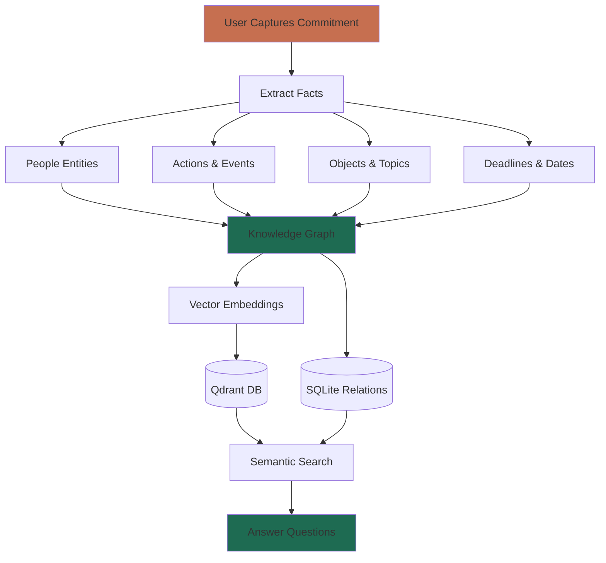

**What's stored**:
- **Episodic memories**: "User captured: Submit report to Sarah by Friday"
- **Semantic facts**: "Report is for Sarah", "Deadline is Friday", "Report relates to Q4 project"
- **Relationships**: Task A blocks Task B, Person X assigned to Task Y
- **Context**: Where fact came from (user capture, email, document)

**Example Memory Entry**:
```
Type: PERSONAL_TASK
Source: USER_CAPTURE
Action: "summarize doc"
Actor: USER
Deadline_Owner: USER
Responsibility: USER_PERFORMS
Contact: None
Relationships: []
```

**Query capabilities**:
- Semantic search: "tasks about reports" finds "send Q4 analysis" even without exact word match
- Relationship traversal: "What blocks Task X?" → Shows dependent tasks
- Temporal queries: "What was promised last week?"
- Person-based: "All commitments involving Sarah"

---

### 3. 📄 Document Intelligence (RAG)

**What it does**: Upload PDFs and ask questions about their content

**How it works**:

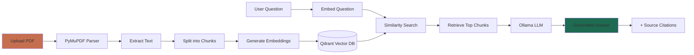

**Document processing**:
1. **Upload**: PDF file selected
2. **Parse**: PyMuPDF extracts text page-by-page
3. **Chunk**: Split into ~500-token sections with overlap
4. **Embed**: Generate vector embeddings via nomic-embed-text
5. **Index**: Store in Qdrant with metadata (page number, document name)

**Query processing**:
1. **Question**: "What are the payment terms in the contract?"
2. **Embed query**: Convert to vector
3. **Search**: Find top 5 most similar chunks via cosine similarity
4. **Context**: Pass chunks + question to LLM
5. **Generate**: LLM produces grounded answer
6. **Cite**: Show source document + page numbers

**Answer formatting**:
- Clean markdown rendering (bold, italic, bullets)
- No inline citation numbers
- Sources section below with document names and pages

**Example interaction**:
```
You: "Summarize the key points in this contract"

Answer:
The contract covers three main areas:
• Payment terms require net-30 invoicing
• Deliverables include Phase 1 completion by March
• Termination clause allows 30-day notice period

📄 Sources:
VendorContract_Acme.pdf (pages 2, 5, 8)
```

**Supported features**:
- Multi-document queries: Compare across multiple PDFs
- Semantic understanding: Answers conceptual questions, not just keyword matching
- Page-level citations: Know exactly where information came from
- Hybrid search: Combine document content with your commitment context

---

### 4. 🤔 Intelligent Assistant

**What it does**: Answer questions using your local data (commitments + documents)

**How it works**:

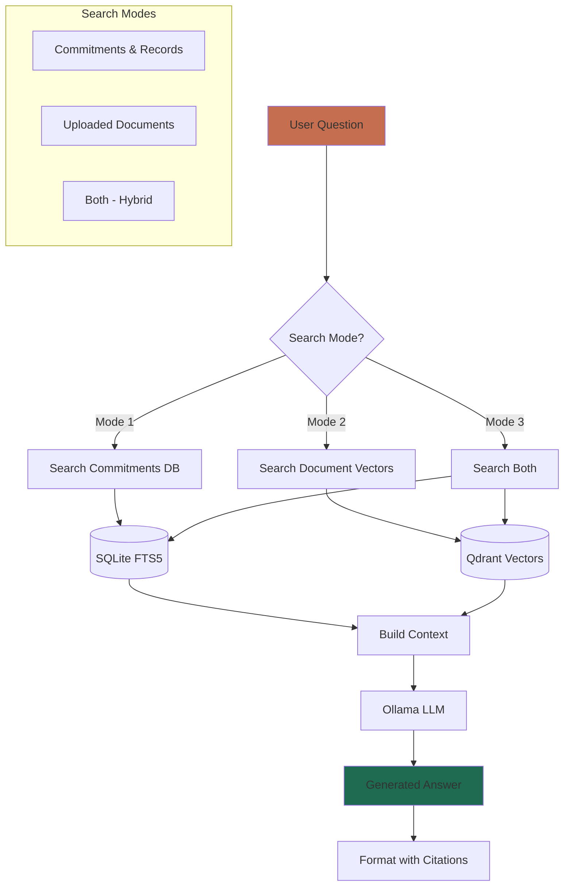

**Search Modes**:

| Mode | Searches | Best For | Example Questions |
|------|----------|----------|-------------------|
| **Commitments & Records** | Your captured tasks, memory graph | Task tracking, follow-ups | "What am I waiting for?"<br>"What's due this week?"<br>"Show me tasks with Sarah" |
| **Uploaded Documents** | PDFs you've uploaded | Document Q&A, research | "Summarize this contract"<br>"What's the deadline in the specs?"<br>"Compare terms in both agreements" |
| **Both (Hybrid)** | Everything | Complex queries spanning both | "What tasks relate to the Smith contract?"<br>"Summarize all Phoenix project info" |

**Query processing steps**:
1. **Parse intent**: What is the user asking?
2. **Route**: Which data sources to search?
3. **Retrieve**: Fetch relevant commitments/documents
4. **Rank**: Score by relevance
5. **Contextualize**: Build prompt with retrieved data
6. **Generate**: LLM produces answer
7. **Cite**: Add source references

**Example queries and responses**:

**Query**: "What am I waiting for?"
```
Mode: Commitments & Records
Processing:
- Search memory for USER_WAITING_FOR type
- Filter active commitments
- Sort by deadline urgency

Answer:
You're waiting for:
• John's approval on proposal (due Friday)
• IT to fix server issue (no deadline)
• Sarah's budget numbers (overdue by 2 days)

Would you like to draft a follow-up email?
```

**Query**: "Summarize the payment terms in all contracts"
```
Mode: Uploaded Documents
Processing:
- Embed query vector
- Search all contract PDFs
- Retrieve chunks mentioning "payment", "terms", "invoice"
- Generate summary

Answer:
Payment terms across your contracts:
• Acme contract: Net-30 invoicing, monthly billing
• Smith agreement: Milestone-based, 50% upfront
• Johnson NDA: No payment terms (confidentiality only)

📄 Sources:
VendorContract_Acme.pdf (page 3)
ClientAgreement_Smith.pdf (page 5)
NDA_Johnson.pdf (page 1)
```

---

### 5. ⏰ Smart Reminders

**What it does**: Proactive notifications before deadlines

**How it works**:

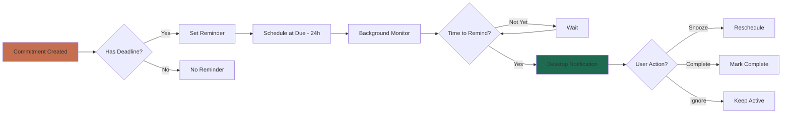

**Reminder features**:
- **Automatic**: Set when deadline is specified
- **Configurable**: Default 24h before, adjustable per commitment
- **Persistent**: Survives app restart (stored in SQLite)
- **Smart snoozing**: "Remind me in 1 hour", "Tomorrow morning", etc.
- **Desktop notifications**: Native OS notifications via Qt

**Reminder logic**:
```
Deadline: Friday 5pm
Reminder: Thursday 5pm (24h before)
Fallback: Friday 4:30pm (30min before, if first missed)
```

**Example notification**:
```
┌─────────────────────────────────────┐
│ ⏰ Pactlyn Reminder                 │
├─────────────────────────────────────┤
│ Send report to Sarah                │
│ Due: Tomorrow at 5pm                │
│                                     │
│ [Complete]  [Snooze]  [View]       │
└─────────────────────────────────────┘
```

---

### 6. 📧 Email Integration (Optional)

**What it does**: Draft, approve, and send follow-up emails with full transparency

**How it works**:

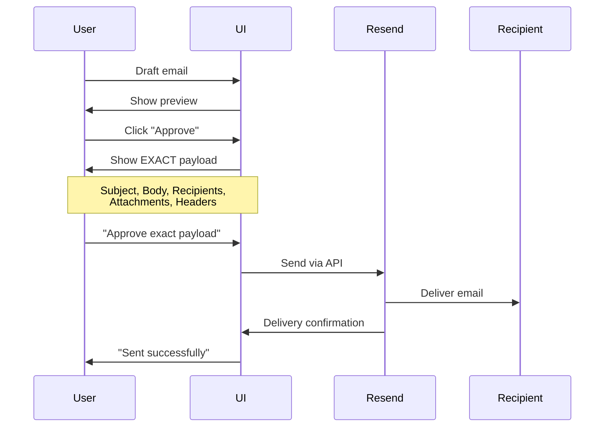

**Key principle**: **No automatic sending. Ever.**

Every email requires two approvals:
1. **Draft approval**: You create and save draft
2. **Payload approval**: You review and approve exact email content

**Email workflow**:

**Step 1: Draft**
```
Email Centre → New Draft
To: sarah@company.com
Subject: Following up on proposal
Body: Hi Sarah, checking in on the proposal I sent last week...
Related commitment: "Waiting for Sarah's approval"
```

**Step 2: Review Payload**
```
From: you@yourcompany.com
To: sarah@company.com
Subject: Following up on proposal
Headers: X-Pactlyn-Commitment: abc-123
Attachments: None

Body:
Hi Sarah, checking in on the proposal I sent last week...

Best regards,
Your Name
```

**Step 3: Approve & Send**
Click "Approve exact payload" → Email queued → Sent via Resend

**Privacy controls**:
- API key stored in OS keyring only (never in SQLite)
- Sender domain must be verified in your Resend account
- No personal Gmail/Outlook sending (Resend limitation)
- Optional: Inbound email polling (explicitly enabled)

**Inbound email** (optional feature):
- Poll Resend inbox for new emails
- Configurable interval (5-60 minutes)
- Extract commitments from email content
- Link to related commitments

---

### 7. 🔍 Full-Text Search

**What it does**: Fast keyword search across all commitments

**How it works**:

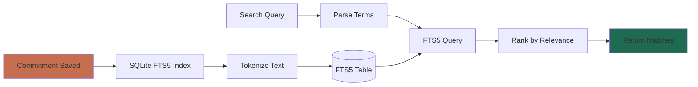

**Search capabilities**:
- **Keyword matching**: Find exact words
- **Prefix search**: "rep" finds "report", "repository"
- **Phrase search**: "Q4 report" finds exact phrase
- **Boolean operators**: "report AND Sarah", "invoice OR bill"
- **Ranking**: Most relevant results first

**Where it's used**:
- Commitments page search box
- Memory page filtering
- Assistant quick lookups

**Example**:
```
Search: "sarah report"
Results (ranked):
1. Send Q4 report to Sarah by Friday (title match + person match)
2. Review Sarah's report before meeting (title match)
3. Report discussed in Sarah's email (context match)
```

---

### 8. 🎨 Themes & Customization

**What it does**: Personalize your Pactlyn experience

**Available themes**:

**Light Theme** (Warm Sand & Forest Pine):
- Warm cream background (#F5F1E8)
- Deep forest green sidebar (#193A35)
- Terracotta accents (#C66F50)
- Optimized for daytime use

**Dark Theme** (Midnight Obsidian Pine):
- Dark obsidian background (#111E1B)
- Darker sidebar (#0C1614)
- Terracotta accents maintained
- Reduced eye strain for night work

**Theme persistence**: Your choice is saved via QSettings and restored on next launch

**Customization options**:
- Settings → General → Color Theme dropdown
- Changes apply immediately across all windows
- Affects all UI components (buttons, inputs, cards, etc.)

---

### 9. 💾 Backup & Restore

**What it does**: Protect your data with encrypted backups

**How it works**:

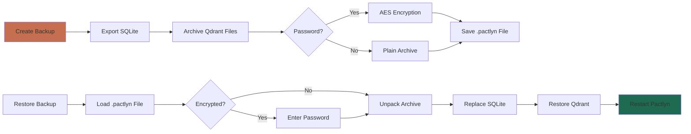

**Backup contents**:
- Complete SQLite database (commitments, memory, email drafts)
- Qdrant vector collections (embeddings)
- Metadata (backup timestamp, version)

**Backup types**:
- **Unencrypted**: Fast, for private storage (external drive)
- **Encrypted**: AES-256, password-protected, safe for cloud storage

**How to backup**:
```
Settings → General → Create backup
Choose location: /path/to/pactlyn-backup-2024-11-05.pactlyn
Optional: Enter password for encryption
Click Save
```

**How to restore**:
```
Settings → General → Restore from backup
Select file: pactlyn-backup-2024-11-05.pactlyn
Enter password (if encrypted)
Confirm: "This will replace current data"
Pactlyn restarts with restored data
```

---

### 10. 🔐 Privacy & Security

**What stays local**:

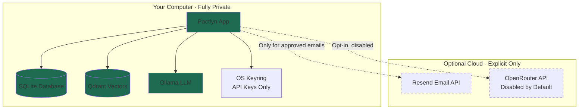

**Data locations**:
- **SQLite**: `~/.local/share/pactlyn/pactlyn.sqlite3`
- **Qdrant**: `~/.local/share/pactlyn/qdrant/`
- **Backups**: User-chosen location
- **API keys**: OS keyring (macOS Keychain, GNOME Keyring, Windows Credential Manager)

**What never leaves your machine**:
- ✅ Commitment text and details
- ✅ Memory graph and relationships
- ✅ Document PDFs and extracted text
- ✅ LLM inference (processed locally via Ollama)
- ✅ Vector embeddings and searches
- ✅ Reminder schedules

**Optional external services**:
- 📧 Resend: Only for approved email sending (explicit payload approval required)
- 🌐 OpenRouter: Disabled by default, must be explicitly enabled with API key

**Security measures**:
- No telemetry or analytics
- No automatic cloud sync
- No external API calls for core features
- API keys encrypted in OS keyring
- Optional backup encryption (AES-256)
- No network access for LLM inference (Ollama is local)

---

## Feature Comparison

### Pactlyn vs Traditional Tools

| Feature | Pactlyn | Todoist | Notion | Obsidian | Evernote |
|---------|---------|---------|--------|----------|----------|
| **Natural Language Understanding** | ✅ AI-powered | ❌ Manual only | ❌ Manual only | ❌ Manual only | ❌ Manual only |
| **Local AI Processing** | ✅ Ollama | ❌ Cloud only | ❌ Cloud only | ✅ Plugins | ❌ Cloud only |
| **Offline Mode** | ✅ Full features | ⚠️ Limited | ⚠️ Limited | ✅ Full | ⚠️ Limited |
| **Privacy (Zero Cloud)** | ✅ 100% local | ❌ Cloud-first | ❌ Cloud-first | ✅ Local | ❌ Cloud-first |
| **Commitment Extraction** | ✅ Auto-extract | ❌ Manual | ❌ Manual | ❌ Manual | ❌ Manual |
| **Document Q&A (RAG)** | ✅ Built-in | ❌ No | ⚠️ Search only | ⚠️ Plugins | ⚠️ Search only |
| **Knowledge Graph** | ✅ Auto-built | ❌ No | ⚠️ Relations | ⚠️ Backlinks | ❌ No |
| **Email Integration** | ✅ Approval-based | ⚠️ One-way | ⚠️ Import only | ❌ No | ✅ Full |
| **Relationship Tracking** | ✅ Semantic | ⚠️ Tags only | ✅ Databases | ⚠️ Links | ⚠️ Tags |
| **Free & Open Source** | ✅ MIT License | ⚠️ Freemium | ⚠️ Freemium | ⚠️ Freemium | ⚠️ Freemium |

---

## Technical Feature Architecture

### Data Flow Overview

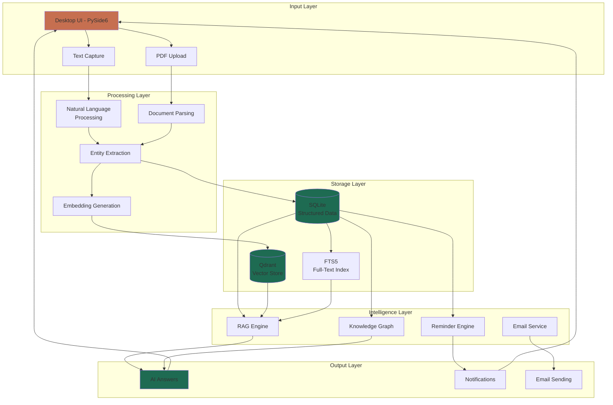

### Component Breakdown

| Component | Technology | Purpose | Data Flow |
|-----------|-----------|---------|-----------|
| **UI Layer** | PySide6 (Qt) | Desktop interface | User input → Backend |
| **LLM Provider** | Ollama | Local inference | Text → Structured output |
| **Document Parser** | PyMuPDF | PDF extraction | PDF → Plain text |
| **Chunker** | Custom | Split documents | Long text → Small chunks |
| **Embedder** | nomic-embed-text | Vector generation | Text → 768-dim vectors |
| **Vector Store** | Qdrant (local) | Similarity search | Vectors → Top-K matches |
| **Relational DB** | SQLite + SQLAlchemy | Structured storage | Entities → SQL tables |
| **FTS Engine** | FTS5 | Keyword search | Text → Inverted index |
| **RAG Engine** | Custom | Context retrieval | Query → Relevant docs |
| **Knowledge Graph** | Custom | Relationship tracking | Entities → Graph relations |
| **Reminder Service** | QTimer + SQLite | Scheduled notifications | Deadlines → Alerts |
| **Email Service** | Resend API | Approved sending | Draft → Delivery |

---

## Quick Start

> **Platform**: Linux (Ubuntu 22.04+ / Debian 12+ recommended). macOS and Windows support is planned.

---

### 🟢 Regular Users — One-time install

This is the recommended path. After these steps Pactlyn will appear in your app menu and you can launch it by clicking its icon — no terminal needed day-to-day.

**Step 1 — Install Ollama and download AI models** (~2.3 GB, one-time)

```bash
# Install Ollama
curl -fsSL https://ollama.com/install.sh | sh

# Pull the two models Pactlyn needs
ollama pull llama3.2:3b        # Chat model  (~2 GB)
ollama pull nomic-embed-text   # Embedding model (~274 MB)
```

> Ollama runs a small local server that keeps your data private. It starts automatically on login after installation.

**Step 2 — Get the Pactlyn source** (until a packaged installer is available)

```bash
git clone https://github.com/yourusername/pactlyn-ai.git
cd pactlyn-ai
```

> If you don't have `git`, install it first: `sudo apt install git`

**Step 3 — Run the installer script**

```bash
./packaging/linux/install-user.sh
```

This single script:
- Installs `uv` (fast Python package manager) if you don't already have it
- Installs the `pactlyn` command into `~/.local/bin`
- Sets up the database automatically
- Adds **Pactlyn** to your application menu (search for it in your launcher)

That's it. Open your app menu, search **Pactlyn**, and launch it.

> **Every subsequent launch**: just click the icon, or type `pactlyn` in a terminal.  
> Make sure Ollama is running (`ollama serve`) if it isn't already.

---

### 🔵 Developers — Run from source

If you want to contribute or run the latest unreleased code:

```bash
git clone https://github.com/yourusername/pactlyn-ai.git
cd pactlyn-ai

# Install all dependencies (including dev tools)
uv sync --extra dev

# Apply database migrations
uv run alembic upgrade head

# Launch
uv run pactlyn
```

---

### First Launch

1. **AI Models** (Settings → AI Models):
   - Pactlyn auto-discovers models running in Ollama
   - Confirm `llama3.2:3b` is selected as chat model
   - Confirm `nomic-embed-text` is selected as embedding model

2. **Capture your first commitment** (Home page):
   - Type: `I need to submit my project report by Friday 5pm`
   - Click **Capture** → review the extracted details → click **Save**
   - Pactlyn will remind you before the deadline

3. **Ask a question** (Assistant page):
   - Type: `What am I waiting for?`
   - Get an AI answer sourced entirely from your local data

### Verify Everything Works

| What to check | Expected result |
|---|---|
| Settings → AI Models → Status | "Connected" |
| Home → type a task → Capture | Review dialog appears with extracted person + date |
| Assistant → ask a question | Answer appears with `[source:…]` citations |
| Documents → upload a PDF → Assistant | Answer appears with `📄 Sources:` section |
| Memory page | Entries visible from your captures |

**Expected response times** (llama3.2:3b on a modern CPU):
- Commitment capture: 10–30 s
- Assistant Q&A: 15–45 s
- Document Q&A: 20–60 s

**Common issues:**
- *"Checking…" stuck in model settings* → run `ollama serve` in a terminal
- *Timeout errors* → try a smaller model (`ollama pull qwen2.5:0.5b`)
- *Qdrant lock error on startup* → delete `~/.local/share/pactlyn/qdrant/.lock`

Full troubleshooting guide: [docs/testing-checklist.md](docs/testing-checklist.md)

---

## How It Works

### For Non-Technical Users

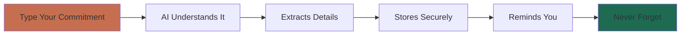

**Simple Workflow:**

1. **Capture**: Type naturally — "Promised Sarah I'd send the document by Wednesday"
2. **Review**: AI extracts who (Sarah), what (send document), when (Wednesday)
3. **Store**: Saved to your local database, searchable forever
4. **Remember**: Get reminded before deadlines
5. **Query**: Ask "What's overdue?" or "What did I promise John?"

**Example Use Cases:**

| You Say | Pactlyn Understands |
|---------|---------------------|
| "Need to email client about invoice by EOD Friday" | Task: Email client<br>Deadline: Friday 5pm<br>Type: USER_PERFORMS |
| "Waiting for John's approval on the proposal" | Person: John<br>Type: USER_WAITING_FOR<br>Action: Approval needed |
| "Remind me to call Mom next Sunday" | What: Call Mom<br>When: Next Sunday<br>Reminder: Created |

### For Technical Users

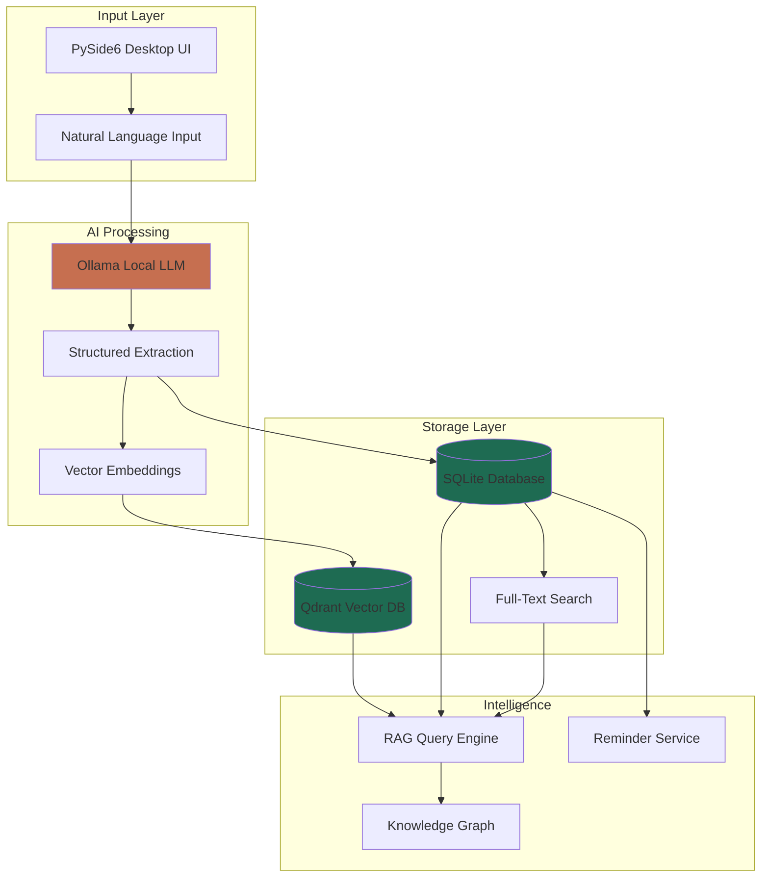

**Architecture Highlights:**

- **Frontend**: PySide6 (Qt) desktop application
- **LLM**: Ollama with pluggable model support (qwen2.5, llama3.2, etc.)
- **Storage**: 
  - SQLite with SQLAlchemy ORM for structured data
  - Qdrant (local mode) for vector embeddings
  - FTS5 for full-text search
- **RAG Pipeline**: 
  - Document chunking with PyMuPDF
  - Semantic search via embedding similarity
  - Context-aware answer generation
- **Privacy**: Zero network calls for core features (post-setup)

**Tech Stack:**

| Component | Technology | Purpose |
|-----------|-----------|---------|
| UI Framework | PySide6 (Qt) | Native desktop interface |
| Database | SQLite + SQLAlchemy | Relational data storage |
| Vector Store | Qdrant (local) | Semantic search embeddings |
| LLM Runtime | Ollama | Local model inference |
| Document Parser | PyMuPDF | PDF text extraction |
| Email | Resend API (optional) | Outbound email with approval |
| Orchestration | LangGraph | Multi-step AI workflows |

---

## Core Concepts

### 1. Commitments vs Memory

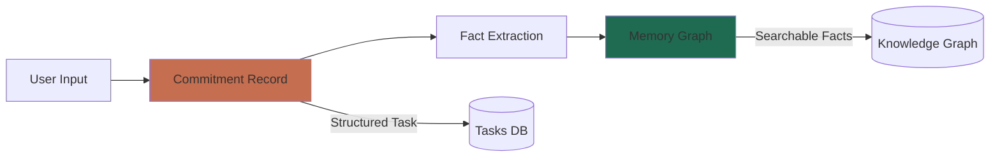

**Commitments**: Actionable tasks with deadlines, people, dependencies
- Example: "Submit report to Sarah by Friday"
- Stored in: Commitments table (SQLite)
- View in: Commitments page

**Memory**: Extracted facts and relationships from all your captures
- Example: "Report is for Sarah", "Deadline is Friday", "Sarah prefers PDF format"
- Stored in: Memory graph (Qdrant vectors + SQLite relations)
- View in: Memory page, queryable via Assistant

### 2. Search Modes in Assistant

| Mode | What It Searches | Use When |
|------|-----------------|----------|
| **Commitments & Records** | Your captured tasks and commitments | "What am I waiting for?" |
| **Uploaded Documents** | PDFs you've uploaded for Q&A | "Summarize this contract" |
| **Both (Hybrid)** | Everything — tasks + documents | "What deadlines relate to the Smith project?" |

### 3. Local-First Privacy

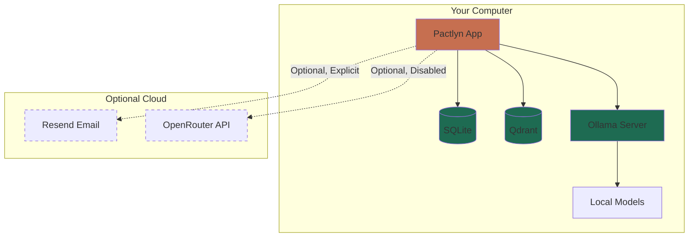

**What Stays Local:**
- ✅ All commitments and tasks
- ✅ Uploaded documents (PDFs)
- ✅ Memory and knowledge graph
- ✅ AI model inference (via Ollama)
- ✅ Embeddings and vector search

**What Requires Internet (Optional):**
- 📧 Sending approved emails via Resend (explicit consent required)
- 🌐 Using OpenRouter cloud models (disabled by default, must be enabled)
- 📥 Polling Resend inbox for inbound emails (optional feature)

---

## Documentation

### User Guides

- 📘 **[How to Use Pactlyn](docs/user-guide.md)** — Complete walkthrough for new users
- 🎯 **[Common Workflows](docs/workflows.md)** — Email tracking, project management, meeting follow-ups
- ⚙️ **[Settings Guide](docs/settings.md)** — Configure models, email, themes
- 🧪 **[Testing Checklist](docs/testing-checklist.md)** — Verify your installation, troubleshoot issues

### Technical Documentation

- 🏗️ **[Architecture Overview](docs/architecture.md)** — System design, data flow, components
- 🔒 **[Privacy & Security](docs/privacy.md)** — How your data is protected
- 📴 **[Offline Mode](docs/offline-mode.md)** — What works without internet
- 📧 **[Email Setup](docs/resend-setup.md)** — Configuring Resend for follow-ups
- 🧪 **[Evaluation Reports](docs/evaluation.md)** — Performance benchmarks and validation

### Development

- 🛠️ **[Developer Setup](docs/development.md)** — Contributing guidelines
- 🧪 **[Testing Guide](docs/testing.md)** — Running tests, coverage reports
- 📊 **[Validation Reports](docs/)** — v0.2, v0.3, v0.5, v0.6, v0.7, v0.8 reports

---

## For Developers

### Development Setup

```bash
# Clone repository
git clone https://github.com/yourusername/pactlyn-ai.git
cd pactlyn-ai

# Install with dev dependencies
uv sync --extra dev

# Initialize database
uv run alembic upgrade head
```

### Running Tests

**Quick functional test** (5 minutes):
```bash
# Start Ollama (separate terminal)
ollama serve

# Run Pactlyn
uv run pactlyn

# Follow testing checklist in docs/testing-checklist.md
```

**Automated test suite**:
```bash
# Run all tests
uv run pytest

# Run with verbose output
uv run pytest -v -s

# Run specific test file
uv run pytest tests/unit/test_capture.py

# Run tests matching pattern
uv run pytest -k "test_commitment"
```

**Code coverage**:
```bash
# Run with coverage
uv run coverage run --source=src/pactlyn -m pytest

# Generate coverage report
uv run coverage report -m

# Generate HTML report
uv run coverage html
# Open htmlcov/index.html in browser
```

**Code quality checks**:
```bash
# Lint with Ruff
uv run ruff check src tests

# Type check with mypy
uv run mypy src

# Format code
uv run ruff format src tests
```

**Complete test guide**: See [docs/testing-checklist.md](docs/testing-checklist.md) for:
- Functional testing scenarios
- Performance benchmarks
- Integration tests
- UI testing
- Troubleshooting guide

### Project Structure

```
pactlyn-ai/
├── src/pactlyn/
│   ├── ui/              # PySide6 desktop interface
│   ├── llm/             # Ollama, OpenRouter providers
│   ├── rag/             # Document RAG pipeline
│   ├── storage/         # SQLAlchemy models
│   ├── graph/           # Knowledge graph logic
│   ├── email/           # Resend integration
│   └── app/             # Application bootstrap
├── docs/                # Documentation
├── evaluation/          # Validation datasets & scripts
├── tests/               # Test suite
└── migrations/          # Alembic database migrations
```

### Key Technologies

**Languages & Frameworks:**
- Python 3.11+ (asyncio, type hints)
- PySide6 for desktop UI
- SQLAlchemy 2.0 for ORM

**AI & ML:**
- Ollama for local LLM inference
- Qdrant for vector embeddings
- LangGraph for workflow orchestration

**Data Storage:**
- SQLite with FTS5 full-text search
- Qdrant local persistent mode
- Alembic for schema migrations

### Contributing

We welcome contributions! See [CONTRIBUTING.md](CONTRIBUTING.md) for:
- Code style guidelines (Ruff, mypy)
- Testing requirements
- PR process
- Development workflow

---

## Challenges & Solutions

### Challenge 1: Privacy vs Convenience

**Problem**: Cloud AI assistants are convenient but expose private data.

**Solution**: Run everything locally with Ollama. Post-setup, zero network calls for core features. Optional cloud services (email) require explicit approval per action.

### Challenge 2: Natural Language Understanding

**Problem**: Converting "I told Sarah I'd send the report by EOD" into structured data is hard.

**Solution**: LangGraph workflows with LLM-powered extraction, user review, and editable fields. Offline fallback uses rule-based parsing when models unavailable.

### Challenge 3: Reminder Accuracy

**Problem**: Users want "next Tuesday" or "end of week" understood correctly.

**Solution**: Dateparser library for natural language dates + explicit ISO format support. Timezone-aware datetime handling.

### Challenge 4: Performance on Consumer Hardware

**Problem**: Large LLMs (70B+) are too slow for desktop use.

**Solution**: 
- Optimized for small models (3B-7B parameters)
- Async processing to keep UI responsive
- Configurable timeouts (600s default)
- Model recommendations: qwen2.5:3b (fast), qwen2.5:7b (balanced)

---

## Roadmap

**Version 0.9 (Current Development)**
- [ ] Enhanced document Q&A with multi-hop reasoning
- [ ] Improved citation formatting
- [ ] Calendar integration (iCal export)
- [ ] Mobile companion app (view-only)

**Version 1.0 (Stable Release)**
- [ ] Windows & macOS support
- [ ] Plugin system for extensibility
- [ ] Advanced relationship tracking
- [ ] Recurring commitment templates

**Future Exploration**
- Voice input integration
- Browser extension for web capture
- Team collaboration (self-hosted server)
- Advanced analytics dashboard

See [docs/roadmap.md](docs/roadmap.md) for detailed plans.

---

## FAQ

**Q: Does Pactlyn send my data to the cloud?**  
A: No. Core features (commitments, memory, document Q&A) run 100% locally. Optional email features require explicit approval per send.

**Q: What models work best?**  
A: For 4GB VRAM: qwen2.5:3b or qwen3:4b. For 8GB+: qwen2.5:7b. Avoid vision models (llava) for text tasks.

**Q: Can I use it offline?**  
A: Yes! After downloading Ollama models, Pactlyn works fully offline for commitments, reminders, and document Q&A.

**Q: How is this different from Todoist/Notion/etc?**  
A: Pactlyn understands natural language, extracts structured data automatically, runs local AI models, and keeps everything private on your device.

**Q: Is my data encrypted?**  
A: Local database is unencrypted (your disk encryption protects it). Backups support password encryption. API keys stored in OS keyring.

**Q: What about Windows/Mac support?**  
A: Currently Linux-only. Windows/Mac support planned for v1.0.

---

## License

MIT License — see [LICENSE](LICENSE) file.

---

## Acknowledgments

Built with:
- [Ollama](https://ollama.com) — Local LLM runtime
- [Qdrant](https://qdrant.tech) — Vector database
- [Qt/PySide6](https://www.qt.io/qt-for-python) — Desktop UI framework
- [SQLAlchemy](https://www.sqlalchemy.org) — Database ORM

---

<div align="center">

**Made with ❤️ for privacy-conscious productivity**

[Report Bug](https://github.com/yourusername/pactlyn-ai/issues) •
[Request Feature](https://github.com/yourusername/pactlyn-ai/issues) •
[Discussions](https://github.com/yourusername/pactlyn-ai/discussions)

</div>
