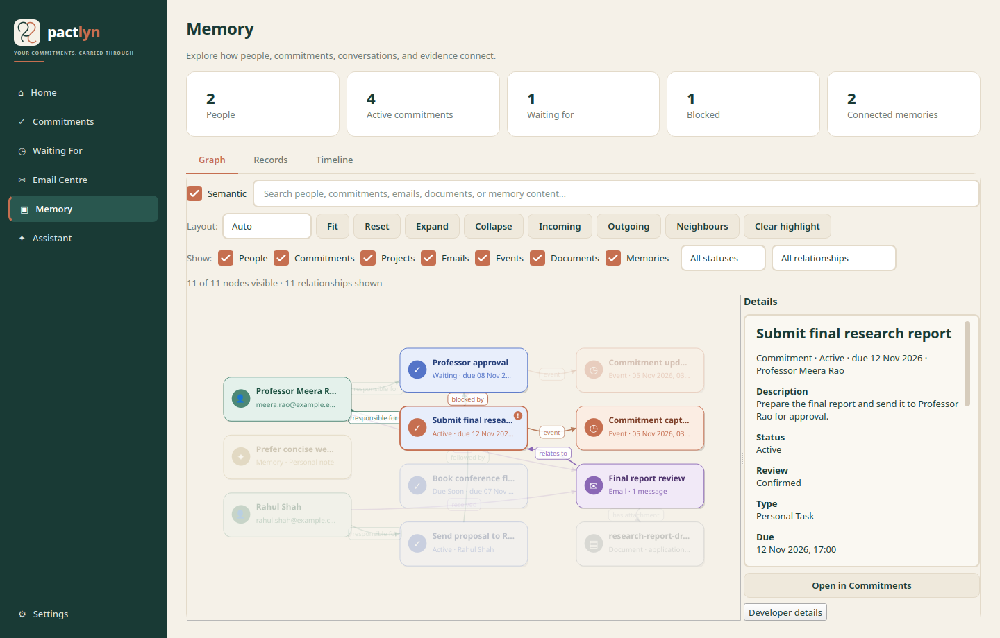
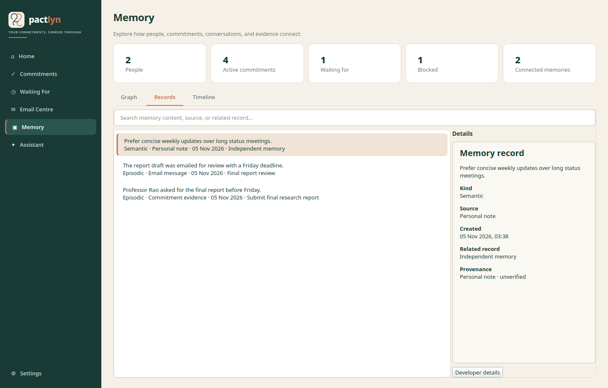
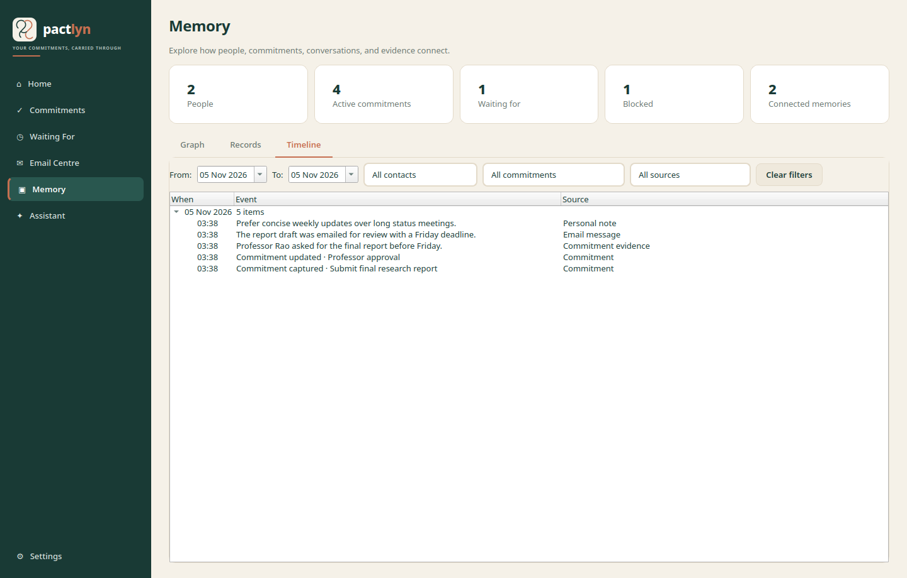

# Memory knowledge graph

Pactlyn's Memory page is a native PySide6 knowledge graph over canonical SQLite
records. It is not a separate graph database, and it does not use React,
JavaScript, or a web view. The graph is an interaction layer over the same
commitments, contacts, personal facts, email threads, attachments, events, and
memory records that the rest of the application uses.

SQLite remains the source of truth. Qdrant remains a semantic index. A
Qdrant match can help a user discover a memory, but semantic similarity never
becomes a causal graph edge.

## Data flow

```text
SQLite canonical rows
  contacts, commitments, commitment_relationships, commitment_events,
  personal_facts, email_threads, email_messages, email_attachments, memory_records
        │
        ▼
KnowledgeGraphRepository (src/pactlyn/memory/graph.py)
  typed nodes + edges + records + timeline + filters + statistics
        │
        ▼
MemoryPage (src/pactlyn/ui/memory_page.py)
  Graph | Records | Timeline
        │
        └── selection/navigation → existing Commitments and Email Centre pages

Qdrant local mode + local embeddings
        │
        ▼
SemanticMemorySearch (src/pactlyn/memory/semantic.py)
  optional related-memory suggestions only
  never creates nodes or edges

RAGService (src/pactlyn/rag/service.py)
  structured personal-fact lookup → answer without LLM when fact is confirmed
  hybrid RAG (FTS5 + Qdrant) as fallback
```

The UI never executes SQL. `KnowledgeGraphRepository.build()` performs the
queries and returns immutable dataclasses. Qt graphics items only paint and
interact with the resulting graph.

## Graph nodes

| Node | Canonical source | Notes |
| --- | --- | --- |
| Person | `Contact`; commitment person/contact fields | Deduplicated by normalized email and then name. Email participants become Person nodes only when they match a stored contact or commitment person. A commitment with neither a person nor a contact email does not create an "Unknown person" node. |
| Commitment | `Commitment` | Shows status, due date, person, and tags such as active, waiting, blocked, overdue, completed, and cancelled. |
| Personal Fact | `PersonalFact` | Birthday, name, university, preferences, career, contact info, and other stable profile attributes. Always linked from the user's person node with a semantic edge. Teal colour. |
| Email | `EmailThread` plus its messages and latest send action | Aggregated by thread. Details include subject, senders, recipients, message count, review status, delivery status, latest message, and links to the related commitment. |
| Event | `CommitmentEvent` with a meaningful type | Only state-change events (confirmed, completed, cancelled, postponed, incoming\_reply) appear as graph nodes. Audit-only events ("created", "updated") are recorded in the Timeline but suppressed from the graph to prevent clutter. |
| Document | `EmailAttachment` | Linked from its email thread with `HAS_ATTACHMENT`. |
| Memory | `MemoryRecord` with no resolvable canonical target | The memory label is the readable content. Linked memory evidence is attached inline to the related commitment, email, person, event, or document instead of duplicating the graph. A memory whose source is missing becomes an independent Memory node. |
| Project | No Project table currently exists | The node kind and filter exist in the model so a future real Project table can be represented. Pactlyn does not fabricate Project nodes. |

Deleted memories and rejected commitment relationships are excluded. A memory
whose source was deleted is still a real memory record and is shown as an
independent node.

## Graph edges and direction

Validated commitment relationship types keep their stored names and exact
direction:

| Edge | Direction |
| --- | --- |
| `BLOCKED_BY` | blocked commitment → commitment that is blocking it |
| `DEPENDS_ON` | dependent commitment → commitment it depends on |
| `FOLLOWED_BY` | earlier commitment → later commitment |
| `RESPONSE_REQUIRED_FROM` | commitment → commitment/person whose response is required, as stored |
| `RELATED_TO` | source → target general association, as stored |
| `SUPERSEDES` | newer commitment → superseded commitment |

Pactlyn also derives explicit associations from stored fields:

| Edge | Direction |
| --- | --- |
| `PERSON_PERFORMS_ACTION` | person → commitment ("responsible for"/"needs contact") |
| `RELATED_TO` | commitment → involved person, when responsibility does not imply the person performs the action |
| `PERSON_SENT_EMAIL` | person → email thread |
| `PERSON_RECEIVES_EMAIL` | person → email thread |
| `EMAIL_RELATES_TO_COMMITMENT` | email thread → commitment |
| `HAS_ATTACHMENT` | email thread → document |
| `HAS_EVENT` | commitment → meaningful state-change event |

Personal-fact edges connect the user's person node to the fact node:

| Edge | Direction |
| --- | --- |
| `HAS_BIRTHDAY` | user → birthday personal fact |
| `HAS_IDENTITY` | user → identity personal fact |
| `STUDIES_AT` | user → education personal fact |
| `WORKS_ON` | user → career personal fact |
| `PREFERS` | user → preference personal fact |
| `HAS_CONTACT_INFO` | user → contact information personal fact |
| `HAS_PERSONAL_FACT` | user → any other personal fact |

Every edge exposes:

* its typed kind and human-readable label;
* direction, rendered with an arrow;
* evidence text where the source record has it;
* confidence for commitment relationships and email/commitment associations;
* validation/review status (`validated`, `reviewed`, `needs_review`, or an
  association derived directly from stored fields);
* provenance/origin and developer-only identifiers.

Commitment relationships are read from `commitment_relationships` and filtered
to exclude `rejected`. Editing a relationship's type or evidence and rebuilding
the graph updates the edge without changing its canonical direction.

## Graph view

The Memory page opens on **Graph** by default.

* **Layout.** `Auto` chooses a layered dependency layout when there are at least
  four dependency relationships and no more than 40 commitments. Otherwise it
  uses a compact relationship-column layout. `Layered` and `Relationship` are
  also available explicitly.
* **Deterministic positions.** Nodes are ordered by relationship-aware anchors
  and stable tie-breakers, so rebuilding the graph produces the same layout for
  the same data.
* **Interaction.** Drag nodes, pan the canvas, wheel-zoom, fit the graph, reset
  the layout, select nodes or edges, and use Incoming/Outgoing/Neighbours
  highlighting. Selecting a node dims unrelated nodes and edges.
* **Expand/collapse.** Expand restores a selected node's hidden neighbours;
  collapse hides them. Filters and hidden neighbours are re-applied safely.
* **Search.** Search covers node labels, subtitles, and loaded memory content.
  Results focus and highlight the matching graph node. Pressing Enter opens the
  first matching result.
* **Semantic discovery.** When local Qdrant and the configured Ollama embedding
  model are available, the **Semantic** checkbox also searches indexed memory
  records. Results appear under "Related memories" and focus the node related to
  the memory. They are suggestions only; no edge is created.
* **Filters.** Filter by entity kind (including Personal Facts), commitment
  status, and relationship group (including "Personal facts"). Filters hide
  non-matching nodes and relationship edges while retaining the surrounding
  canonical context.
* **Details.** A node detail panel shows stored fields, evidence, review status,
  connections, provenance, and recent activity. Edge details show endpoints,
  review status, evidence, confidence, and developer identifiers. Technical
  fields (IDs, raw values, confidence scores, indexing state) are hidden behind
  **Developer details** and not shown by default.
* **Navigation.** Commitment details can open the existing Commitments page;
  email and document details can open the existing Email Centre. Memory node
  actions open the Records view.
* **Empty and partial states.** An empty database shows a clear empty-state card
  with actions to capture a commitment or ask the assistant. A single node or a
  disconnected graph renders normally. Long labels are elided but remain
  available in tooltips, details, and the Records view.
* **Refresh.** Database changes rebuild the graph. Node positions are preserved
  for nodes that still exist, and zoom/pan are preserved unless the graph was
  previously empty or the user asks to fit/reset.

## Records view

The Records view lists non-deleted memory records in reverse chronological order.
Each row shows readable content, kind, source, date, and related record.

Personal-fact records receive a distinct human-friendly display:

```
Birthday

18 August 2005

Personal profile · Birthday · Confirmed

Source: Your original statement.
```

Other memory records show content, kind, source, created time, related record,
and provenance. Technical metadata (source IDs, confidence, indexing state) is
collapsed behind **Developer details** and hidden by default.

Search in Records is local SQLite-backed text search over content, kind, source,
related label, and provenance.

## Timeline view

The Timeline view groups loaded commitment events and memory records by date.
Rows show the time, readable event or memory content, and source.

Audit-only commitment events ("Commitment captured", "Commitment updated") are
hidden from the timeline by default. Only meaningful state-change events
(confirmed, completed, cancelled, postponed, reply received) and personal-fact
events are shown. This prevents repeated "Commitment captured ·" entries from
drowning out the meaningful history.

Personal-fact events appear as "{Attribute} remembered · {value}", for example:

```
Date Of Birth remembered · 18 August 2005
Personal profile · Birthday
```

Filters support a date range, contact, commitment, and source. Double-clicking a
memory item opens its record; double-clicking an event focuses its commitment in
the graph.

## Native graphics and limits

The graph uses `QGraphicsScene`, `QGraphicsView`, custom `QGraphicsItem` nodes
and edges, and native Qt painting/event handling. There is no embedded browser.

Performance safeguards:

* `KnowledgeGraphRepository.build(max_nodes=600)` applies per-query row caps and
  a hard total node cap. When the cap is reached, the most connected and most
  recent nodes are retained, dangling edges are removed, and the graph summary
  says that the graph was trimmed for performance.
* The Timeline loads a bounded set of events/memories; the graph initially shows
  at most three meaningful events per commitment.
* Relationship layouts are deterministic and use fixed spacing, so they avoid
  overlap without an unbounded physics simulation.
* Edge labels are painted when the view scale is at least 0.45; the toolbar and
  mouse wheel provide zoom and fit controls.
* A large graph scrolls/pans instead of blocking the UI thread.

## Database tables

Personal facts use:

* `personal_facts` — canonical structured personal-fact rows (added in migration
  `a0_personal_facts`).
* `personal_fact_fts` — FTS5 virtual table for keyword retrieval, created by
  `init_database()` alongside `commitment_fts`.
* Qdrant collection `personal_facts` — embedding vectors for semantic retrieval.

## Screenshots

The screenshots use a temporary sample database. They are real Pactlyn desktop
renders, not mockups.

### Graph



### Records



### Timeline



## Tests

* `tests/memory/test_memory_graph.py` covers canonical construction, typed edge
  direction, rejection/deletion, deduplication, memory provenance, search,
  filters, statistics, update/deletion rebuilding, the total node cap, and the
  no-fabricated-person rule.
* `tests/memory/test_personal_facts.py` covers `InputClassifier` classification
  (birthday, name, education, preference, commitment, waiting-for, follow-up,
  event, multi-class), `PersonalFactService` persistence and idempotency,
  structured RAGService retrieval for birthday/name/university questions,
  unanswerable questions, `PERSONAL_FACT` graph nodes, audit-event suppression,
  and the birthday-commitment migration helper.
* `tests/memory/test_semantic_search.py` covers local Qdrant retrieval mapping
  back to canonical memory and empty-index behavior.
* `tests/ui/test_memory_page.py` covers empty, single-node, and disconnected
  states, details/actions, edge selection, search, filters, expand/collapse,
  records, timeline, memory activation, semantic-result rendering, zoom/fit/
  reset/theme/resize, long labels, refresh, and an offscreen visual render.
